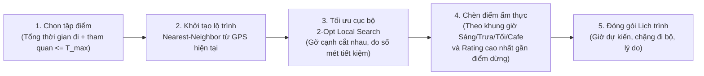

# 3. Đặc tả Chi tiết 3 Trụ cột Hệ thống Thông minh & Gamification

Tài liệu này mô tả chi tiết mô hình toán học, thuật toán AI, quy tắc xác thực vật lý và cơ chế dự phòng (**Graceful Fallback**) của 3 trụ cột thông minh được cài đặt trong `backend/app/services/`.

---

## 3.1. Trụ cột 1: Gợi ý Ngữ cảnh Giải thích được & Lập Lịch trình Đi bộ Tối ưu (`2-Opt`)

Cài đặt tại: [`backend/app/services/recommendation_service.py`](../backend/app/services/recommendation_service.py)

### A. Mô hình Chấm điểm Đa tiêu chí Giải thích được (Explainable Context-Aware Scoring)

Thay vì chỉ sắp xếp đơn thuần theo khoảng cách, mỗi di tích $i$ được tính điểm phù hợp $S(i) \in [0, 1]$ theo công thức tổng hợp có trọng số:

$$S(i) = 0.30 \cdot S_{\text{dist}}(i) + 0.25 \cdot S_{\text{novelty}}(i) + 0.20 \cdot S_{\text{category}}(i) + 0.15 \cdot S_{\text{rating}}(i) + 0.10 \cdot S_{\text{status}}(i)$$

| Thành phần | Trọng số | Công thức & Ý nghĩa |
| :--- | :---: | :--- |
| $S_{\text{dist}}(i)$ | **30%** | $S_{\text{dist}}(i) = \exp(-d / R)$ — Suy giảm mượt theo khoảng cách địa lý thực tế $d$ từ vị trí GPS người dùng. |
| $S_{\text{novelty}}(i)$ | **25%** | $1.0$ nếu người dùng **chưa từng check-in** điểm đó; $0.25$ nếu đã ghé thăm trước đó để ưu tiên trải nghiệm mới. |
| $S_{\text{category}}(i)$ | **20%** | Mức độ khớp giữa danh mục di tích (`monument`, `museum`, `temple`, `imperial`, `ancient_town`) với sở thích người dùng chọn hoặc suy luận từ lịch sử đã đi. |
| $S_{\text{rating}}(i)$ | **15%** | Điểm đánh giá chuẩn hóa có hiệu chỉnh độ tin cậy theo số lượng đánh giá (**Bayesian Average**). |
| $S_{\text{status}}(i)$ | **10%** | Điểm thưởng cho Di tích Quốc gia Đặc biệt / Di sản UNESCO và đang mở cửa tại thời điểm truy vấn. |

Mỗi kết quả gợi ý trả về kèm danh sách lý do giải thích **`reasons[]`** theo ngôn ngữ đang chọn (`vi/en/fr/zh/ja`), ví dụ: *"Cách bạn chỉ 320m"*, *"Bạn chưa từng ghé thăm"*, *"Di tích Quốc gia Đặc biệt"*.

### B. Thuật toán Lập Lịch trình Đi bộ Nhiều điểm (`Smart Walking Tour Planner`)

- **Khung giờ tự động chèn ẩm thực (`meal_slots`):**
  - **Sáng (`breakfast`):** `06:00 – 10:00`
  - **Trưa (`lunch`):** `11:00 – 14:00`
  - **Chiều / Nghỉ chân (`cafe`):** `14:00 – 17:30`
  - **Tối (`dinner`):** `17:30 – 21:00`

---

## 3.2. Trụ cột 2: Trợ lý AI Hướng dẫn viên Hỏi–Đáp RAG (5 Ngôn ngữ)

Cài đặt tại: [`backend/app/services/rag_service.py`](../backend/app/services/rag_service.py)

1. **Truy xuất lai (`Hybrid Retrieval + RRF`):**
   - Hỗ trợ 5 ngôn ngữ: `vi`, `en`, `fr`, `zh`, `ja`. Nếu người dùng đang mở chi tiết một di tích cụ thể (`site_id`), bộ truy xuất ưu tiên phạm vi tri thức của di tích đó trước.
   - Chạy song song **Vector Cosine Similarity** (`pgvector` / cosine trên embedding JSON) và **Lexical / Full-Text Search** (`ts_rank` / khớp từ khóa có trọng số) trên **340 đoạn tri thức** (`summary`, `script`, `architecture`, `restaurant`).
   - Hợp nhất bảng xếp hạng bằng **Reciprocal Rank Fusion (RRF)**:
     $$\text{RRF}(d) = \sum_{r \in \{\text{vector}, \text{lexical}\}} \frac{1}{k + \text{rank}_r(d)}$$
     để chọn **Top-5** đoạn tri thức liên quan nhất.
2. **Sinh câu trả lời bám sát nguồn (`Grounded Generation`):**
   - Gọi **Google Gemini 2.5 Flash** (`google-genai`) với system prompt ràng buộc chỉ trả lời dựa trên ngữ cảnh truy xuất được (chống AI bịa đặt sự kiện lịch sử), trả về kèm **`citations[]`** và 3 câu hỏi gợi ý tiếp theo **`suggested_questions[]`**.
3. **Cơ chế Dự phòng Thông minh (`Smart Structured Fallback`):**
   - Khi chưa có `GEMINI_API_KEY`, mất mạng hoặc chạm giới hạn quota, hệ thống tự động tổng hợp câu trả lời có cấu trúc từ Top-3 đoạn tri thức khớp nhất (kèm giờ mở cửa, giá vé, điểm nhấn kiến trúc và gợi ý quán ăn gần nhất) để demo và kiểm thử luôn ổn định 100%.

---

## 3.3. Trụ cột 3: Vision AI Nhận diện Di tích & Chống Gian lận Check-in (`Anti-Fake`)

### A. Vision AI Nhận diện Di tích qua Camera
Cài đặt tại: [`backend/app/services/vision_service.py`](../backend/app/services/vision_service.py)

1. Nhận ảnh chụp (Base64/upload) kèm tọa độ GPS hiện tại (`lat`, `lng`).
2. **Tiền lọc theo không gian (GPS Candidate Pre-filtering):** Lọc Top-8 di tích gần tọa độ GPS nhất để đưa vào ngữ cảnh nhận diện, giúp tăng độ chính xác và giảm mạnh chi phí token.
3. Gọi **Gemini Vision** trả về `matched_site_id`, độ tin cậy `confidence` ($0.0 - 1.0$), đặc điểm kiến trúc nhận ra `architectural_cues[]` và cờ `auto_open_audio = true` khi `confidence >= 0.70`.
4. Nếu chưa cấu hình `GEMINI_API_KEY`, tự động chuyển sang chế độ `gps_fallback` trả về ứng viên gần GPS nhất kèm nhãn trạng thái minh bạch.

### B. Động cơ Xác thực Chống Gian lận Đi bộ (`Anti-Fake Walk Verifier`)
Cài đặt tại: [`backend/app/services/antifake_service.py`](../backend/app/services/antifake_service.py)

Hệ thống chấm điểm xác thực từ `0` đến `100` điểm dựa trên **4 quy tắc vật lý**:

| STT | Tiêu chí kiểm tra | Trọng số | Quy tắc đánh giá |
| :---: | :--- | :---: | :--- |
| 1 | **Khoảng cách đích (GPS Geofence)** | **+40 điểm** | Tọa độ check-in nằm trong bán kính $\le 200\text{m}$ quanh tọa độ di tích mục tiêu. |
| 2 | **Tốc độ đi bộ vật lý** | **+35 điểm** | Vận tốc trung bình $v = d / t$ nằm trong ngưỡng đi bộ hợp lý $0.3 - 2.5\text{ m/s}$ ($1.1 - 9.0\text{ km/h}$). Nếu $v > 4.0\text{ m/s}$ (đi xe máy/ô tô hoặc giả mạo GPS) sẽ bị đánh dấu bất thường. |
| 3 | **Tính liên tục quỹ đạo lộ trình** | **+15 điểm** | Các điểm tọa độ liên tiếp trong `route_coordinates` không xuất hiện bước nhảy tức thời (*teleport*) phi vật lý. |
| 4 | **Xác thực ảnh Vision AI (tùy chọn)** | **+10 điểm** | Ảnh chụp kỷ niệm được Vision AI xác nhận khớp đúng `site_id` đang check-in. |

**Phân loại trạng thái Check-in & Ảnh hưởng tới Bảng xếp hạng Cộng đồng:**
- **`verified`** (*Điểm $\ge 70$ và không bật chế độ mô phỏng*): Được công nhận chính thức, cộng vào **Global Leaderboard** và xét mở khóa Huy hiệu.
- **`simulated`** (*Khi người dùng dùng nút "Mô phỏng đi bộ" để demo*): Lưu vào nhật ký cá nhân để trình diễn, **không** cộng vào Bảng xếp hạng Cộng đồng.
- **`flagged`** (*Nghi vấn GPS ngoài vùng geofence hoặc tốc độ di chuyển bất thường*): Vẫn lưu lịch sử kèm chi tiết nguyên nhân cảnh báo, **không** cộng điểm cộng đồng.

---

## 3.4. Hệ thống 6 Huy hiệu Thành tựu Tự động (Gamification Badges)

Cài đặt tại: [`backend/app/services/badge_service.py`](../backend/app/services/badge_service.py)

Mỗi khi có hành trình `verified` hoặc tải ảnh kỷ niệm mới, động cơ huy hiệu tự động đối chiếu và mở khóa ngay lập tức:

| Mã huy hiệu (`code`) | Tên hiển thị | Điều kiện tự động mở khóa |
| :--- | :--- | :--- |
| `first_step` | **Bước Chân Di Sản** | Hoàn thành và xác thực GPS check-in tại di tích đầu tiên. |
| `district1_master` | **Chinh Phục Quận 1** | Ghé thăm ít nhất **5 di tích lịch sử** thuộc khu vực trung tâm Quận 1. |
| `museum_lover` | **Tín Đồ Bảo Tàng** | Khám phá tối thiểu **3 bảo tàng** trong hệ thống di sản TP.HCM. |
| `heritage_photographer` | **Săn Ảnh Di Sản** | Lưu trữ ít nhất **5 bức ảnh kỷ niệm** check-in trên Cloud Album. |
| `walking_marathon` | **Nhà Thám Hiểm Bộ Hành** | Tích lũy tổng thời gian đi bộ được xác thực **$\ge 60$ phút** hoặc quãng đường **$\ge 5\text{ km}$**. |
| `saigon_explorer` | **Sứ Giả Văn Hóa Sài Gòn** | Chinh phục từ **10 di tích trở lên** trên toàn địa bàn TP.HCM. |
