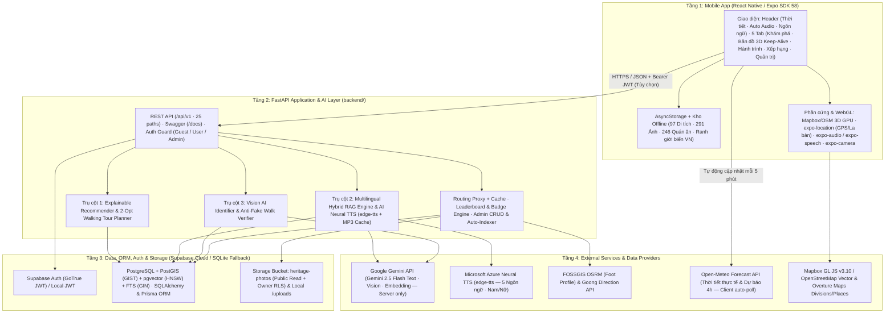

# 1. Kiến trúc Hệ thống Tổng thể

Tài liệu này tổng hợp các quyết định thiết kế kỹ thuật và kiến trúc phân lớp (**Layered Clean Architecture**) của hệ thống **Smart Heritage Guide** nhằm đáp ứng yêu cầu chiều sâu về AI, xử lý không gian địa lý 3D hiệu năng cao, bảo mật khóa API và trải nghiệm di động **Offline-First & Tự động cập nhật thông minh**.

---

## 1.1. Tổng hợp Quyết định Thiết kế

| Hạng mục | Quyết định thiết kế đã triển khai |
| :--- | :--- |
| **Mục tiêu cốt lõi** | Đồ án môn *Phát triển các Hệ thống Thông minh* — nhấn mạnh chiều sâu AI, thuật toán gợi ý/tối ưu lộ trình theo ngữ cảnh & thời tiết, xử lý không gian địa lý 3D; kiến trúc sạch, minh bạch, dễ demo và bảo vệ. |
| **Client kết nối** | Ứng dụng di động `mobile/` (React Native / Expo SDK 58) theo cơ chế **Offline-First** (tích hợp sẵn 97 địa điểm, 291 ảnh thực tế & 246 quán ăn nội bộ, vẫn hoạt động mượt khi mất mạng hoặc Backend chưa bật). |
| **Điều hướng & UX thông minh** | 5 tab dưới Taskbar tách bạch (**Khám phá · Bản đồ · Hành trình · Xếp hạng · Quản trị** theo quyền `admin`) + thanh Header dùng chung chứa **Pill Thời tiết trực tiếp (`☀️ 30°`)**, **nút Tự động thuyết minh 1 chạm (`🔊`/`🔇`)**, **Ngôn ngữ (`vi/en/fr/zh/ja`)** và **Tài khoản**. |
| **Bản đồ 3D WebGL** | **Mapbox GL JS `v3.10.0`** (`theme: 'faded'`, bảng màu Warm-Editorial `#FAF9F6 / #141413 / #B93815`, đồng bộ màu toàn bộ đường & cầu — loại bỏ hoàn toàn cầu vàng) kèm **MapLibre OSM Vector 3D** & Leaflet fallback; toàn bộ ghim di sản, gom cụm (`cluster`) & quán ăn render bằng **GPU WebGL 60–120fps**; ranh giới cắt theo **biên giới biển Việt Nam (Overture `maritime`)** & bờ biển OSM (~33m); chuyển tab Bản đồ tức thì **0ms** nhờ **Keep-Alive + Pre-Warm**. |
| **Xác thực (Auth)** | Chế độ **Khách (Guest)** dùng ngay không chặn màn hình đăng nhập + Đăng nhập tùy chọn (Email/Mật khẩu) qua Supabase GoTrue Auth + bảng `profiles` + Storage RLS, bọc qua FastAPI Auth API để hỗ trợ nút **Authorize** ngay trên Swagger `/docs`. |
| **3 Trụ cột Thông minh** | (1) Gợi ý ngữ cảnh giải thích được & Lập tour đi bộ tối ưu `2-Opt` kết hợp **Thời tiết trực tiếp (Open-Meteo)**.<br>(2) Trợ lý AI Hỏi–Đáp **Hybrid RAG** 5 ngôn ngữ (Gemini 2.5 Flash + Fallback cục bộ).<br>(3) **Vision AI** nhận diện di tích qua Camera + Xác thực chống gian lận GPS/tốc độ đi bộ. |
| **Giọng đọc (Neural TTS)** | **Microsoft Azure Neural Voices** qua `edge-tts` trên Backend (miễn phí, không cần API key, hỗ trợ Giọng Nữ Hoài My / Giọng Nam Nam Minh & 5 ngôn ngữ, có **MP3 cache** tại `uploads/tts_cache/` + thanh tiến độ thời gian thực 0–100%), tự động fallback về `expo-speech` đã chuẩn hóa văn bản tiếng Việt khi offline. |
| **Quản trị dữ liệu & ORM** | Quản trị trực tiếp ngay trên Mobile qua **Admin Dashboard + Interactive Map Picker (`AdminDashboardView.tsx`, `AdminMapPickerModal.tsx`)** song song với Swagger `/docs`; đồng bộ 9 bảng qua cả **SQLAlchemy Async** (FastAPI) và **Prisma ORM** (`backend/prisma/`, dùng chung `backend/.env` với `DATABASE_URL` PgBouncer & `DIRECT_URL`). |
| **Hành trình & Tự cập nhật** | Đồng bộ nhật ký hành trình ngầm lên Cloud, lưu ảnh lên Supabase Storage (`heritage-photos`), tự động làm mới Thời tiết (5 phút / đổi GPS / mở lại app) và Bảng xếp hạng Cộng đồng + 6 Huy hiệu thành tựu (60 giây / ngay khi check-in). |
| **Chỉ đường (Routing)** | Routing Proxy + Cache 7 ngày trên Backend (`Route Cache → FOSSGIS OSRM foot → Goong Direction → Fallback`), ẩn hoàn toàn `GOONG_API_KEY` khỏi client; hỗ trợ **dẫn đường đi bộ 3D Heading-Up** có la bàn trên Mobile. |
| **Triển khai (Deploy)** | Chạy Local bằng Uvicorn + SQLite/Supabase Cloud; đóng gói sẵn `Dockerfile`, `docker-compose.yml` và `render.yaml` để deploy Cloud 1 chạm. |

---

## 1.2. Sơ đồ Kiến trúc 4 Tầng



---

## 1.3. Phân tách Trách nhiệm các Tầng

1. **Tầng Client (`mobile/`):**
   - Hiển thị bản đồ 3D WebGL 60–120fps (`MapExplorer.tsx`, giữ sống nền qua Keep-Alive + Pre-Warm), thu thập GPS & la bàn thời gian thực (`locationService.ts`), cập nhật thời tiết tự động (`weatherService.ts`), phát thuyết minh AI Neural MP3 kèm offline fallback (`speechService.ts`, `speechTextUtils.ts`), chụp ảnh camera (`PhotoCaptureModal.tsx`), quản trị Admin có Map Picker (`AdminDashboardView.tsx`, `AdminMapPickerModal.tsx`), lưu đệm cục bộ (`AsyncStorage`) và gọi REST API qua `src/services/apiClient.ts` (có `AbortController` timeout).
   - Toàn bộ ứng dụng thống nhất sử dụng **1 font chữ duy nhất `Times New Roman`** (`mobile/src/theme.ts` & `mobile/index.ts`, không dùng `Georgia`) để chống lỗi dấu tiếng Việt tổ hợp.
2. **Tầng FastAPI Gateway & Services (`backend/app/`):**
   - Xác thực JWT từ Supabase Auth (kèm Local JWT fallback), kiểm soát phân quyền `Guest / User / Admin`.
   - Bảo vệ tuyệt đối các khóa bí mật phía server (**Zero Secret on Client**: `GEMINI_API_KEY`, `GOONG_API_KEY`, `SUPABASE_SERVICE_ROLE_KEY`, `DATABASE_URL`, `DIRECT_URL`, `JWT_SECRET_KEY`). Mobile chỉ đọc các biến công khai `EXPO_PUBLIC_API_BASE_URL` và `EXPO_PUBLIC_MAPBOX_ACCESS_TOKEN`.
   - Thực thi nghiệp vụ AI, Neural TTS có MP3 cache trên đĩa, thuật toán không gian, anti-fake, quản trị dữ liệu và tự động tái lập chỉ mục tri thức RAG khi Admin cập nhật di tích.
3. **Tầng Dữ liệu (`Supabase Cloud` + `Prisma ORM` + `SQLite Local Fallback`):**
   - Trên Cloud: PostgreSQL kết hợp `PostGIS` (truy vấn không gian), `pgvector` (tìm kiếm vector ngữ nghĩa 768 chiều) và `tsvector` (Full-Text Search), quản lý schema đồng bộ giữa `001_initial_schema.sql`, SQLAlchemy ORM và `backend/prisma/schema.prisma`.
   - Khi phát triển cục bộ hoặc chạy kiểm thử `pytest`: tự động chuyển sang SQLite async (`aiosqlite`) và tự động seed dữ liệu nếu DB trống để đảm bảo CI/CD và demo không bao giờ gián đoạn.

---

## 1.4. Cấu trúc Mã nguồn Monorepo

```text
smart-heritage-guide/
├── .github/workflows/ci.yml       # CI 3 cổng: Standards/Secret Guard, Backend pytest/OpenAPI, Mobile TS/Vitest/Web
├── CONTRIBUTING.md                # Quy chuẩn kiến trúc, font chữ, bảo mật & GitHub Flow
├── README.md                      # Hướng dẫn khởi chạy nhanh
├── docs/                          # Bộ tài liệu kiến trúc & đặc tả kỹ thuật (.md)
├── backend/
│   ├── app/
│   │   ├── main.py                # Khởi tạo FastAPI, CORS, Swagger /docs, /uploads, lifespan auto-seed
│   │   ├── core/                  # config.py, database.py, security.py
│   │   ├── models/entities.py     # 9 bảng SQLAlchemy ORM
│   │   ├── schemas/dto.py         # Pydantic v2 Request/Response DTOs (bao gồm TtsSynthesizeRequest)
│   │   ├── routers/               # health, auth, sites, admin, ai (+tts), routing, journeys, leaderboard
│   │   └── services/              # geo, recommendation, rag, tts, vision, antifake, routing, badge, storage
│   ├── prisma/                    # schema.prisma, client.ts, seed.ts (dùng chung backend/.env với FastAPI)
│   ├── supabase/migrations/       # 001_initial_schema.sql (PostGIS, pgvector, indexes, RLS)
│   ├── scripts/                   # seed_supabase.py, sync_wikipedia_data.py, sync_overture_places.py,
│   │                              # sync_multilingual_parity.py
│   ├── tests/                     # 7 bộ kiểm thử tự động pytest (AI, TTS, Anti-Fake, RAG, Vision, Routing, Smoke)
│   └── Dockerfile | docker-compose.yml | render.yaml | pytest.ini | requirements.txt | package.json
└── mobile/
    ├── App.tsx | index.ts | app.json | package.json
    └── src/
        ├── theme.ts               # Hệ màu Warm-Editorial, spacing & APP_FONT (Times New Roman)
        ├── types/heritage.ts      # TypeScript DTOs đồng bộ với Backend
        ├── data/                  # 97 di tích TP.HCM hợp nhất (7 module vùng), 18 CITY_PRESETS,
        │                          # overtureRestaurants.ts (246 quán), wikipediaEnrichment.ts (291 ảnh),
        │                          # vietnamMapBounds.ts (ranh giới biển VN & TP.HCM)
        ├── utils/                 # geoUtils.ts (+test), speechTextUtils.ts
        ├── services/              # apiClient, aiService, authService, adminService, locationService,
        │                          # weatherService (+test), speechService (+test), routingService (+test),
        │                          # mapTiles, journeyStorage
        └── components/            # MapExplorer (3D WebGL), SiteMiniMap, SiteCard, WeatherWidgetCard,
                                   # AudioGuidePlayer, HeritageDetailModal, PhotoCaptureModal,
                                   # JourneyAndRankingView, AiChatModal, SmartTourModal, AuthModal,
                                   # AdminDashboardView, AdminMapPickerModal
```
