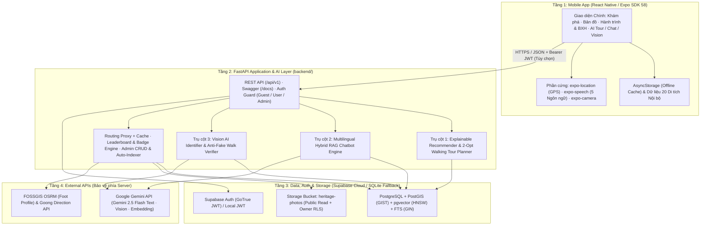

# 1. Kiến trúc Hệ thống Tổng thể

Tài liệu này tổng hợp các quyết định thiết kế kỹ thuật và kiến trúc phân lớp (**Layered Clean Architecture**) của hệ thống **Smart Heritage Guide** nhằm đáp ứng yêu cầu chiều sâu về AI, xử lý không gian địa lý, bảo mật khóa API và trải nghiệm di động **Offline-First**.

---

## 1.1. Tổng hợp Quyết định Thiết kế

| Hạng mục | Quyết định thiết kế đã chốt |
| :--- | :--- |
| **Mục tiêu cốt lõi** | Đồ án môn *Phát triển các Hệ thống Thông minh* — nhấn mạnh chiều sâu AI, thuật toán gợi ý/tối ưu lộ trình và xử lý không gian địa lý; kiến trúc sạch, minh bạch, dễ demo và bảo vệ. |
| **Client kết nối** | Phục vụ ứng dụng di động `mobile/` (React Native / Expo SDK 58) theo cơ chế **Offline-First** (vẫn hoạt động mượt khi mất mạng hoặc Backend chưa bật). |
| **Xác thực (Auth)** | Chế độ **Khách (Guest)** dùng ngay không chặn màn hình đăng nhập + Đăng nhập tùy chọn (Email/Mật khẩu) qua Supabase GoTrue Auth + bảng `profiles` + Storage RLS, bọc qua FastAPI Auth API để hỗ trợ nút **Authorize** ngay trên Swagger `/docs`. |
| **3 Trụ cột Thông minh** | (1) Gợi ý ngữ cảnh giải thích được & Lập tour đi bộ tối ưu `2-Opt`.<br>(2) Trợ lý AI Hỏi–Đáp RAG 5 ngôn ngữ (Gemini 2.5 Flash + Fallback cục bộ).<br>(3) Vision AI nhận diện di tích qua Camera + Xác thực chống gian lận GPS/tốc độ đi bộ. |
| **Giọng đọc (TTS)** | Sử dụng `expo-speech` ngay trên thiết bị (miễn phí, chạy offline ổn định, đồng bộ highlight từng đoạn lời thoại, không phụ thuộc Neural TTS từ server). |
| **Quản lý dữ liệu** | Seed 20 di tích lịch sử TP.HCM & 26 quán ăn đặc sản lên DB + API truy vấn không gian + API Admin CRUD trực tiếp trên Swagger `/docs` (không xây Web Admin riêng). |
| **Hành trình & Cộng đồng** | Đồng bộ nhật ký hành trình, lưu ảnh lên Supabase Storage (`heritage-photos`), Bảng xếp hạng Cộng đồng xác thực (`Global Leaderboard`) và 6 Huy hiệu thành tựu tự động (`Badges`). |
| **Chỉ đường (Routing)** | Routing Proxy + Cache 7 ngày trên Backend (`Route Cache -> FOSSGIS OSRM foot -> Goong Direction -> Fallback`), ẩn hoàn toàn `GOONG_API_KEY` khỏi client. |
| **Triển khai (Deploy)** | Chạy Local bằng Uvicorn + SQLite/Supabase Cloud; đóng gói sẵn `Dockerfile`, `docker-compose.yml` và `render.yaml` để deploy Cloud 1 chạm. |

---

## 1.2. Sơ đồ Kiến trúc 4 Tầng



---

## 1.3. Phân tách Trách nhiệm các Tầng

1. **Tầng Client (`mobile/`):**
   - Hiển thị giao diện bản đồ, thu thập GPS thời gian thực (`expo-location`), phát thuyết minh đa ngôn ngữ (`expo-speech`), chụp ảnh camera (`expo-camera` / `expo-image-picker`), lưu bộ đệm cục bộ (`AsyncStorage`) và gọi REST API qua `src/services/apiClient.ts` (có `AbortController` timeout).
   - Toàn bộ ứng dụng thống nhất sử dụng **1 font chữ duy nhất `Times New Roman`** (`mobile/src/theme.ts` & `mobile/index.ts`) để chống lỗi dấu tiếng Việt tổ hợp.
2. **Tầng FastAPI Gateway & Services (`backend/app/`):**
   - Xác thực JWT từ Supabase Auth (kèm Local JWT fallback), kiểm soát phân quyền `Guest / User / Admin`.
   - Bảo vệ tuyệt đối các khóa bí mật phía server (**Zero Secret on Client**: `GEMINI_API_KEY`, `GOONG_API_KEY`, `SUPABASE_SERVICE_ROLE_KEY`, `DATABASE_URL`, `JWT_SECRET_KEY`).
   - Thực thi nghiệp vụ AI, thuật toán không gian, anti-fake, quản trị dữ liệu và tự động tái lập chỉ mục tri thức RAG khi Admin cập nhật di tích.
3. **Tầng Dữ liệu (`Supabase Cloud` + `SQLite Local Fallback`):**
   - Trên Cloud: PostgreSQL kết hợp `PostGIS` (truy vấn không gian), `pgvector` (tìm kiếm vector ngữ nghĩa 768 chiều) và `tsvector` (Full-Text Search).
   - Khi phát triển cục bộ hoặc chạy kiểm thử `pytest`: tự động chuyển sang SQLite async (`aiosqlite`) và tự động seed dữ liệu nếu DB trống để đảm bảo CI/CD và demo không bao giờ gián đoạn.

---

## 1.4. Cấu trúc Mã nguồn Monorepo

```text
smart-heritage-guide/
├── .github/workflows/ci.yml       # CI 3 cổng: Standards, Backend pytest/OpenAPI, Mobile TS/Vitest/Web
├── CONTRIBUTING.md                # Quy chuẩn kiến trúc, font chữ, bảo mật & GitHub Flow
├── README.md                      # Hướng dẫn khởi chạy nhanh
├── docs/                          # Bộ tài liệu kiến trúc & đặc tả kỹ thuật (.md)
├── backend/
│   ├── app/
│   │   ├── main.py                # Khởi tạo FastAPI, CORS, Swagger /docs, lifespan auto-seed
│   │   ├── core/                  # config.py, database.py, security.py
│   │   ├── models/entities.py     # 9 bảng SQLAlchemy ORM
│   │   ├── schemas/dto.py         # Pydantic v2 Request/Response DTOs
│   │   ├── routers/               # health, auth, sites, admin, ai, routing, journeys, leaderboard
│   │   └── services/              # geo, recommendation, rag, vision, antifake, routing, badge, storage
│   ├── supabase/migrations/       # 001_initial_schema.sql (PostGIS, pgvector, indexes, RLS)
│   ├── scripts/seed_supabase.py   # Seed idempotent 20 di tích, 26 quán ăn, 340 RAG chunks, 6 huy hiệu
│   ├── tests/                     # 40 unit & integration tests (pytest)
│   └── Dockerfile | docker-compose.yml | render.yaml | pytest.ini | requirements.txt
└── mobile/
    ├── App.tsx | index.ts | app.json | package.json
    └── src/
        ├── theme.ts               # Hệ màu, spacing & APP_FONT (Times New Roman)
        ├── types/heritage.ts      # TypeScript DTOs đồng bộ với Backend
        ├── data/                  # 20 di tích TP.HCM & CITY_PRESETS chạy Offline
        ├── utils/                 # geoUtils.ts + unit tests
        ├── services/              # apiClient, aiService, authService, location, speech, routing, mapTiles, storage
        └── components/            # MapExplorer, SiteMiniMap, AudioGuidePlayer, HeritageDetailModal,
                                   # PhotoCaptureModal, JourneyAndRankingView, AiChatModal, SmartTourModal, AuthModal
```
