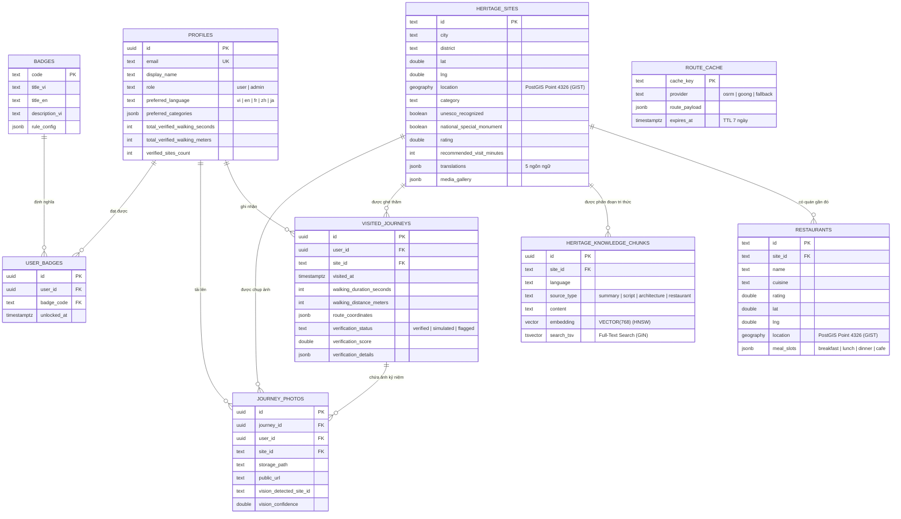

# 2. Thiết kế Cơ sở Dữ liệu (PostgreSQL + PostGIS + pgvector & Prisma ORM)

Cơ sở dữ liệu của **Smart Heritage Guide** được thiết kế cho **Supabase Cloud (PostgreSQL)** tại file migration [`backend/supabase/migrations/001_initial_schema.sql`](../backend/supabase/migrations/001_initial_schema.sql), đồng bộ 100% với **9 mô hình ORM SQLAlchemy** tại [`backend/app/models/entities.py`](../backend/app/models/entities.py) và **Prisma ORM Schema** tại [`backend/prisma/schema.prisma`](../backend/prisma/schema.prisma) (hỗ trợ Dual-DB chạy tự động với SQLite khi dev/test cục bộ).

---

## 2.1. Các Extension Bắt buộc trên Supabase

| Extension | Vai trò trong Hệ thống |
| :--- | :--- |
| **`postgis`** | Lưu tọa độ dạng `GEOGRAPHY(Point, 4326)` tự động sinh từ `(lng, lat)`. Hỗ trợ tính khoảng cách chính xác trên mặt cầu Trái Đất (`ST_Distance`) và lọc bán kính siêu nhanh (`ST_DWithin`) bằng chỉ mục không gian **`GIST`**. |
| **`vector` (`pgvector`)** | Lưu trữ vector embedding **768 chiều** (`VECTOR(768)`) cho kho tri thức di tích và quán ăn, hỗ trợ truy vấn độ tương đồng Cosine (`vector_cosine_ops`) tốc độ cao bằng chỉ mục **`HNSW`**. |
| **`pgcrypto`** | Sinh khóa chính `UUID` (`gen_random_uuid()`) cho hồ sơ người dùng, nhật ký hành trình, ảnh chụp, các đoạn tri thức RAG và lịch sử mở khóa huy hiệu. |

---

## 2.2. Sơ đồ Quan hệ Thực thể (ER Diagram)



---

## 2.3. Chi tiết 9 Bảng Dữ liệu & Chỉ mục (Indexes)

| STT | Tên bảng | Các cột chính & Chỉ mục tối ưu | Vai trò |
| :---: | :--- | :--- | :--- |
| 1 | **`profiles`** | `id` (UUID PK), `email` (Unique), `password_hash`, `display_name`, `avatar_url`, `role` (`user`/`admin`), `preferred_language`, `preferred_categories` (JSONB), `total_verified_walking_seconds`, `total_verified_walking_meters`, `verified_sites_count`.<br>**Index:** `role`, `total_verified_walking_seconds DESC`, `total_verified_walking_meters DESC`, `verified_sites_count DESC`. | Lưu hồ sơ người dùng, sở thích cá nhân hóa và chỉ số tích lũy cho Bảng xếp hạng Cộng đồng. |
| 2 | **`heritage_sites`** | `id` (TEXT PK), `city`, `district`, `lat`, `lng`, `location` (`GEOGRAPHY(Point, 4326)`), `category`, `unesco_recognized`, `national_special_monument`, `rating`, `review_count`, `ticket_price`, `address`, `cover_image`, `recommended_visit_minutes`, `translations` (JSONB 5 ngôn ngữ), `media_gallery` (JSONB).<br>**Index:** `GIST(location)`, `category`, `district`. | Lưu **50 di tích TP.HCM** seed sẵn trên Supabase (cùng dữ liệu mở rộng từ Admin CRUD & đồng bộ chuẩn 97 điểm trên Mobile). |
| 3 | **`restaurants`** | `id` (TEXT PK), `site_id` (FK), `name`, `cuisine`, `specialty_dishes` (JSONB), `rating`, `review_count`, `price_range`, `lat`, `lng`, `location` (`GEOGRAPHY(Point, 4326)`), `address`, `open_hours`, `meal_slots` (JSONB), `image_url`.<br>**Index:** `site_id`, `GIST(location)`, `rating DESC`. | Lưu **56 quán ăn tuyển chọn** trên DB (và 246 quán ăn thực tế từ Overture Maps trên Mobile), lọc theo rating và khung giờ ăn (`breakfast`/`lunch`/`dinner`/`cafe`). |
| 4 | **`heritage_knowledge_chunks`** | `id` (UUID PK), `site_id` (FK), `language`, `source_type` (`summary`/`script`/`architecture`/`restaurant`), `content`, `embedding` (`VECTOR(768)`), `embedding_json` (JSONB cho SQLite), `search_tsv` (`TSVECTOR`).<br>**Index:** `(site_id, language)`, `source_type`, `GIN(search_tsv)`, `HNSW(embedding vector_cosine_ops)`. | Kho tri thức gồm **850 đoạn văn bản** (cân bằng 1-1 đủ 5 ngôn ngữ) phục vụ truy xuất lai (Hybrid Retrieval) cho Trợ lý AI RAG. |
| 5 | **`visited_journeys`** | `id` (UUID PK), `user_id` (FK), `site_id` (FK), `visited_at`, `walking_duration_seconds`, `walking_distance_meters`, `route_coordinates` (JSONB), `user_note`, `user_rating` (1–5), `verification_status` (`verified`/`simulated`/`flagged`), `verification_score`, `verification_details` (JSONB).<br>**Index:** `(user_id, visited_at DESC)`, `site_id`, `verification_status`. | Nhật ký hành trình đi bộ của người dùng kèm kết quả chấm điểm chống gian lận Anti-Fake. |
| 6 | **`journey_photos`** | `id` (UUID PK), `journey_id` (FK), `user_id` (FK), `site_id` (FK), `storage_path`, `public_url`, `caption`, `lat`, `lng`, `walking_duration_seconds_at_capture`, `vision_detected_site_id`, `vision_confidence`, `taken_at`.<br>**Index:** `journey_id`, `user_id`, `site_id`. | Lưu liên kết ảnh kỷ niệm trên Supabase Storage (hoặc `/uploads` cục bộ) kèm kết quả nhận diện Vision AI. |
| 7 | **`badges`** | `code` (TEXT PK), `title_vi`, `title_en`, `description_vi`, `icon_name`, `rule_config` (JSONB). | Danh mục định nghĩa 6 huy hiệu thành tựu tự động của hệ thống. |
| 8 | **`user_badges`** | `id` (UUID PK), `user_id` (FK), `badge_code` (FK), `unlocked_at`.<br>**Unique:** `(user_id, badge_code)`. | Lịch sử mở khóa huy hiệu của từng người dùng (đảm bảo mỗi huy hiệu chỉ mở 1 lần). |
| 9 | **`route_cache`** | `cache_key` (TEXT PK), `origin_lat`, `origin_lng`, `dest_lat`, `dest_lng`, `provider` (`osrm`/`goong`/`fallback`), `route_payload` (JSONB), `expires_at` (TTL 7 ngày).<br>**Index:** `expires_at`. | Bộ đệm tuyến đường đi bộ giúp giảm độ trễ và tránh vượt giới hạn request của OSRM/Goong. |

---

## 2.4. Tích hợp Prisma ORM Song Song với FastAPI (`backend/prisma/`)

Ngoài SQLAlchemy Async phục vụ FastAPI, dự án cung cấp đầy đủ **Prisma ORM** hợp nhất ngay trong `backend/` dùng chung 1 file `backend/.env` và 1 cơ sở dữ liệu Supabase PostgreSQL:

- [`backend/prisma/schema.prisma`](../backend/prisma/schema.prisma): Định nghĩa đủ 9 model (`Profile`, `HeritageSite`, `Restaurant`, `HeritageKnowledgeChunk`, `VisitedJourney`, `JourneyPhoto`, `Badge`, `UserBadge`, `RouteCache`), hỗ trợ tách **`DATABASE_URL`** (Supabase PgBouncer Transaction Pooler) và **`DIRECT_URL`** (kết nối trực tiếp cho `prisma db push` / migration).
- [`backend/prisma/client.ts`](../backend/prisma/client.ts): Singleton helper cho Prisma Client.
- [`backend/prisma/seed.ts`](../backend/prisma/seed.ts): Seeder TypeScript idempotent cho môi trường Node/Prisma.

```bash
# Khởi tạo schema & seed qua Prisma trong thư mục backend/
npm run db:setup
```

---

## 2.5. Chính sách Supabase Storage, RLS & Bộ Script Đồng bộ Dữ liệu

- **Storage Bucket `heritage-photos`:**
  - **Public Read:** Cho phép ứng dụng Mobile tải và hiển thị ảnh album nhanh chóng mà không cần ký URL từng lần.
  - **Authenticated Write / Delete (RLS):** Đường dẫn chuẩn là `{user_id}/{journey_id}/{filename}`. Chỉ người dùng đã đăng nhập đúng `user_id` hoặc vai trò `admin` mới có quyền ghi/xóa ảnh.
- **Bộ 4 Script Tự động hóa Dữ liệu ([`backend/scripts/`](../backend/scripts/)):**
  1. [`seed_supabase.py`](../backend/scripts/seed_supabase.py): Seed idempotent **50 di tích TP.HCM**, **56 quán ăn tuyển chọn**, **850 đoạn tri thức RAG** (hỗ trợ sinh vector embedding nếu bật `--embeddings` và có `GEMINI_API_KEY`), **6 huy hiệu**, **tài khoản Admin** và **tài khoản Demo** (3 hành trình & 2 huy hiệu sẵn).
  2. [`sync_wikipedia_data.py`](../backend/scripts/sync_wikipedia_data.py): Truy vấn Wikipedia API (VI/EN) & Wikimedia Commons để làm giàu **291 ảnh thực tế** và tư liệu lịch sử/kiến trúc vào `mobile/src/data/wikipediaEnrichment.ts`.
  3. [`sync_overture_places.py`](../backend/scripts/sync_overture_places.py): Truy vấn Overture Maps (`2026-11-18.0`) qua DuckDB để đồng bộ **246 hàng quán thực tế** quanh các di tích vào `mobile/src/data/overtureRestaurants.ts`.
  4. [`sync_multilingual_parity.py`](../backend/scripts/sync_multilingual_parity.py): Chuẩn hóa **đồng bộ 1-1 nội dung 5 ngôn ngữ** (`vi | en | fr | zh | ja`) từ bản tiếng Việt (trung bình `3.40` đoạn thuyết minh và `3.08` điểm nhấn kiến trúc mỗi ngôn ngữ) và nạp lên Supabase PostgreSQL.
